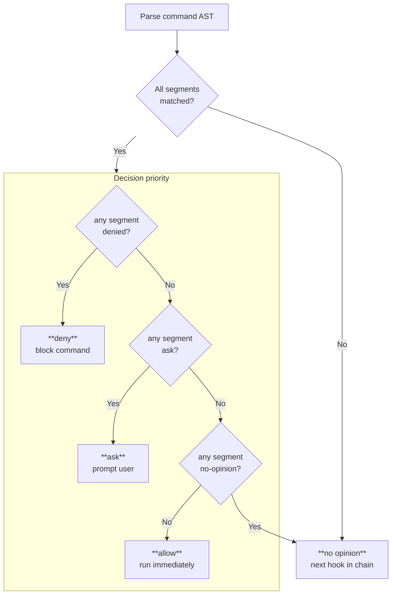

# claude-bash-approve

A command approval runtime for Claude Code and OpenCode. It auto-approves safe Bash commands, repo-scoped `Read`/`Grep` calls for Claude Code, and blocks dangerous operations. Written in Go for fast startup.

This branch is the maintained OpenCode-oriented port. It is based on upstream
commit `a81006c2950d23c3d2c81e1faecd695865728d53`; see
[`PROVENANCE.md`](PROVENANCE.md), [`NOTICE`](NOTICE) and the unchanged MIT
[`LICENSE`](LICENSE).

A reusable pi package is also included under `packages/pi-bash-approve/` for protecting pi `bash`, `read`, `grep`, `find`, and `ls` tool calls via the same Go runtime.

## Install

Use unified installer:

```bash
python3 install.py install --target claude
python3 install.py install --target opencode
python3 install.py install --target opencode --scope project
python3 install.py install --target opencode --scope both
python3 install.py install --target codex
python3 install.py install --target codex --scope project
python3 install.py install --target codex --scope both
python3 install.py install --target all
```

For `opencode` and `codex`, default `--scope` is `global`.

Uninstall uses same entrypoint:

```bash
python3 install.py uninstall --target claude
python3 install.py uninstall --target opencode --scope both
python3 install.py uninstall --target codex --scope both
python3 install.py uninstall --target all
```

Installer requirements:

- Python 3.11+
- the exact Go version in `hooks/bash-approve/go.mod` (currently Go 1.26.3)

Shared runtime installs to `$XDG_DATA_HOME/claude-bash-approve` when `XDG_DATA_HOME` is an absolute path, else `~/.local/share/claude-bash-approve`.

### Production OpenCode deployment

Use the Linux x86-64 archive produced by the **Linux x86-64 artefact** GitHub
Actions workflow. The archive contains the prebuilt `approve-bash` executable,
the stock `categories.yaml`, the maintained `opencode-balanced.yaml`, a
per-file `SHA256SUMS`, exact `BUILD-INFO.json`, and
`LICENSE`/`NOTICE`/`PROVENANCE.md`/`THIRD_PARTY_LICENSES.txt`. The adjacent
`.tar.gz.sha256` covers the archive itself. The third-party bundle is generated
from every external Go module linked into the Linux x86-64 binary and checked
against the build dependency graph by CI.

Production integration should execute the binary directly, with a bounded
timeout and a controlled environment supplied by OpenCode. Pass an explicit
absolute configuration path and disable state access explicitly:

```text
/absolute/path/approve-bash --opencode --config /absolute/path/opencode-balanced.yaml --no-telemetry
```

OpenCode static permission allows run first and remain unchanged. The plugin's
evaluator handles only Bash calls that still produce an unresolved static ask;
it can resolve those asks but does not replace or broaden the static policy.
The maintained policy is intentionally explicit and never selects `all`.

It was selected from a private calibration against an observed 117-row
static-ask corpus: balanced produced **65 allow / 2 ask / 50 noop**, while the
convenience policy produced **69 allow / 3 ask / 45 noop**. Balanced sacrifices
only four direct allows while bounding the category surface exposed by future
matcher additions.

Before deployment, verify both checksum layers and retain the policy checksum
with the build provenance:

```bash
sha256sum -c approve-bash_VERSION_linux_amd64.tar.gz.sha256
mkdir approve-bash-verified
tar -xzf approve-bash_VERSION_linux_amd64.tar.gz -C approve-bash-verified
cd approve-bash-verified
sha256sum -c SHA256SUMS
sha256sum opencode-balanced.yaml
cat BUILD-INFO.json
```

Configure the wrapper or direct invocation with the verified absolute
`opencode-balanced.yaml` path. Do not substitute the stock `categories.yaml`,
which intentionally preserves upstream's `all` policy.

The process reads exactly one JSON object from stdin and writes exactly one
decision object to stdout. Decisions are `allow`, `deny`, `ask`, or `noop`.
Malformed input and configuration failures return an explicit `deny`; `noop`
is reserved for valid inputs on which the runtime has no decision. The legacy
adapter remains available, but production OpenCode integration does not need
it.

The runtime never downloads dependencies or compiles itself. Legacy shim
scripts only execute an already-installed binary and fail back to the host's
manual approval path if it is absent. `install.py` is a source installer and
therefore builds once during installation; it is not the production artefact
path.

Build and protocol identity can be inspected without stdin:

```bash
approve-bash --version
approve-bash --version-json
```

`--version-json` is the strict machine-readable identity endpoint used by the
OpenCode evaluator. It emits exactly `implementation`, `version`, `commit`,
`protocol`, and `platform`; diagnostic build-date and Go-version details remain
in human-readable `--version` output and release `BUILD-INFO.json`. Existing
decision objects are unchanged except that explicit input or configuration
failures may include an `error` code.

### Claude Code

In Claude Code:

```
/plugin install github:mariusvniekerk/claude-bash-approve
```

For local/manual install, run `python3 install.py install --target claude`.

## How it works

When Claude Code is about to run a matched tool call, this hook intercepts it and makes one of four decisions:

- **deny** — command is blocked (with a reason shown to Claude)
- **ask** — recognized command, user is prompted to confirm (terminal — no further hooks run) (e.g. `git tag v1.0.0`)
- **no opinion** — hook has nothing to say, exits silently so the next hook in the chain can handle it (e.g. `git push`, `gh pr create`, or unrecognized commands)
- **allow** — command runs immediately, no prompt



Commands are parsed into an AST (using [mvdan/sh](https://github.com/mvdan/sh)) so chained commands (`&&`, `||`, `;`, `|`), subshells, command substitutions (`$(…)`), and control flow (`if`, `for`, `while`) are all handled correctly — every segment must be safe for the whole command to be approved.

For `Read` and `Grep`, the hook auto-approves only when the referenced paths stay inside the current Git repo or linked worktree root derived from the incoming `cwd`. Anything outside that boundary falls back to no-opinion.

### Wrappers + Commands

The hook uses a compositional model: a command is split into **wrappers** (prefixes like `timeout 30`, `env`, `VAR=val`) and a **core command** (like `git status`, `pytest`). Both are matched against regex patterns organized into categories.

## Alternative installation

```bash
git clone https://github.com/mariusvniekerk/claude-bash-approve.git
cd claude-bash-approve
python3 install.py install --target claude
```

OpenCode installs write plugin files under project/global OpenCode config and point them at shared runtime hook. Codex installs enable `hooks` and write `PermissionRequest` hook config pointing at shared runtime hook.

TypeScript support for the OpenCode and pi integrations is enforced through the
root Vite+ typecheck: `bun run typecheck`.

This repo also includes `prek.toml` for pre-commit checks:

```bash
prek install --prepare-hooks
```

Configured hooks run:

- builtin whitespace / EOF / large-file checks
- `uv run python -m unittest -v install_test.py`
- `cd hooks/bash-approve && go test ./...`
- `cd hooks/bash-approve && golangci-lint run ./...`
- `bun run typecheck` for both TypeScript workspaces through Vite+

### Manual setup

1. Clone this repo:

```bash
git clone https://github.com/mariusvniekerk/claude-bash-approve.git
```

2. Add hook to Claude Code settings (`~/.claude/settings.json`):

```json
{
  "hooks": {
    "PreToolUse": [
      {
        "matcher": "Bash",
        "hooks": [
          {
            "type": "command",
            "command": "~/.local/share/claude-bash-approve/run-hook.sh"
          }
        ]
      },
      {
        "matcher": "Read|Grep",
        "hooks": [
          {
            "type": "command",
            "command": "~/.local/share/claude-bash-approve/run-hook.sh"
          }
        ]
      }
    ]
  }
}
```

3. Build and copy the runtime hook bundle into the shared data dir (or extract
   the prebuilt CI artefact instead):

```bash
runtime_root="${XDG_DATA_HOME:-$HOME/.local/share}/claude-bash-approve"
mkdir -p "$runtime_root"
cp hooks/bash-approve/*.go "$runtime_root"/
cp hooks/bash-approve/go.mod hooks/bash-approve/go.sum "$runtime_root"/
cp .claude-plugin/plugin.json "$runtime_root"/plugin.json
cp hooks/bash-approve/categories.yaml hooks/bash-approve/run-hook.sh "$runtime_root"/
go -C hooks/bash-approve build -trimpath -buildvcs=false -o "$runtime_root/approve-bash" .
chmod +x "$runtime_root/run-hook.sh"
```

4. Hooks execute the prebuilt binary. They never build or download anything at
   runtime.

## Configuration

Command categories are configured in `hooks/bash-approve/categories.yaml` for
Bash command matching. That file preserves the upstream `all` policy. Our
OpenCode integration instead requires
`hooks/bash-approve/opencode-balanced.yaml` and passes its explicit absolute
path; it does not fall back to the stock file or to implicit `all`. An absent
deployment policy falls back to OpenCode's ask flow without running the binary.
Other shipped wrappers continue to select the stock file explicitly. `Read`
and `Grep` are governed by repo/worktree path checks instead.

### Enabled / Disabled

```yaml
# Approve everything except git push
enabled:
  - all
disabled:
  - git push
```

```yaml
# Only approve git and shell commands
enabled:
  - git
  - shell
```

`disabled` always overrides `enabled` — use it to carve out exceptions.

### Safe `cd` Prefixes

By default, `cd` is approved only for the current Git repo, its subdirectories, or linked worktrees from the same repo. To approve additional directory trees, add absolute paths under `safe_cd_prefixes`:

```yaml
enabled:
  - all
safe_cd_prefixes:
  - /tmp/project-scratch
  - /Users/me/worktrees
```

Relative prefixes are ignored. The `cd` target and any existing configured prefix are resolved through symlinks before comparison, so a symlink under an allowed prefix that points outside the prefix is not approved.

### Safe Environment-Variable Prefixes

Project-specific environment-variable namespaces can extend the built-in
allowlist through `safe_env_prefixes`:

```yaml
safe_env_prefixes:
  - ACME_
  - MY_PROJECT_TEST_
```

Configured prefixes are additive. Empty prefixes are ignored, and the existing
hard-deny and ask-only variables (such as `LD_PRELOAD` and `PATH`) retain
precedence even when a configured prefix would otherwise match them.

### Default decisions by command

Most matched commands are auto-approved. Some have different defaults:

| Decision | Commands |
|----------|----------|
| **deny** (blocked, reason shown to Claude) | `git stash`, `git revert`, `git reset --hard`, `git checkout .`, `git clean -f`, `rm -r`, `go mod vendor`, `roborev tui` |
| **ask** (terminal, user prompted) | `git tag` creation and mutation |
| **no-opinion** (deferred to next hook) | `git push`, `jj git push`, `gh pr create`, `go mod init` |

To override a default, add the specific command name to `enabled` or `disabled`.

### Available categories

**Coarse groups** (enable/disable entire ecosystems):

`wrapper`, `git`, `jj`, `python`, `node`, `rust`, `make`, `shell`, `gh`, `go`, `kubectl`, `gcloud`, `bq`, `aws`, `acli`, `roborev`, `docker`, `ruby`, `brew`, `shellcheck`, `grpcurl`

**Fine-grained names** (within each group):

| Group | Names |
|-------|-------|
| wrapper | `timeout`, `nice`, `env`, `env vars` (validates names against allowlist), `.venv`, `bundle exec`, `rtk proxy`, `command`, `node_modules/.bin`, `absolute path` (validates path prefix) |
| git | `git read op` (including `git tag` list/query forms), `git write op`, `git push`, `git tag` creation/mutation, `git destructive` (`git stash`, `git revert`, `git reset --hard`, `git checkout .`, `git clean -f`) |
| jj | `jj read op`, `jj write op`, `jj git push` |
| python | `pytest`, `python`, `ruff`, `uv`, `uvx` |
| node | `npm`, `npx`, `node -e`, `playwright`, `vp`, `bun`, `bunx`, `vitest` |
| rust | `cargo`, `maturin` |
| shell | `read-only`, `sed` (denies in-place), `awk` (denies system/pipe/redirect), `tee` (in-repo only), `touch`, `mkdir`, `cp -n`, `ln -s`, `shell builtin`, `shell vars`, `process mgmt`, `eval`, `echo`, `cd`, `source`, `sleep`, `var assignment`, `shell destructive` (`rm -r`) |
| go | `go`, `go mod vendor`, `go mod init`, `golangci-lint`, `ginkgo` |
| gh | `gh read op`, `gh pr create`, `gh write op`, `gh api` |
| kubectl | `kubectl read op`, `kubectl write op`, `kubectl port-forward`, `kubectl exec`, `kubectl cp` |
| docker | `docker`, `docker compose`, `docker-compose` |
| ruby | `rspec`, `rake`, `ruby`, `rails`, `bundle`, `gem`, `rubocop`, `solargraph`, `standardrb` |

See `categories.yaml` for the full reference with examples.

## Telemetry

Every decision is logged to a local SQLite database in the user state directory. If `XDG_STATE_HOME` is set to an absolute path, the database lives at `$XDG_STATE_HOME/claude-bash-approve/telemetry.db`; otherwise it defaults to `~/.local/state/claude-bash-approve/telemetry.db`.

Telemetry contains the raw hook payload and extracted command. Commands can
contain paths, arguments, environment assignments, tokens or other sensitive
material. When telemetry is enabled, the runtime restricts its application
state directory to mode `0700` and its SQLite database, journal, WAL and shared
memory files to mode `0600`.

For production OpenCode mode, pass `--no-telemetry`. In that mode the runtime
does not open, migrate or create the SQLite database and does not create the
state directory.

On first run, the hook also performs a one-time migration from the common legacy path `~/.claude/hooks/bash-approve/telemetry.db` when that file exists. This lets you review what the hook approved, denied, or passed through:

```bash
state_home="${XDG_STATE_HOME}"
if [ -z "$state_home" ] || [ "${state_home#/}" = "$state_home" ]; then
  state_home="$HOME/.local/state"
fi
sqlite3 "$state_home/claude-bash-approve/telemetry.db" \
  "SELECT ts, agent, binary_version, decision, command, reason FROM decisions ORDER BY ts DESC LIMIT 20"
```

The `binary_version` column records the `claude-bash-approve` build used for each decision. Installed runtimes read it from the copied plugin metadata; source-tree runs fall back to Go build information.

Telemetry is best-effort — if the database can't be opened or written to, the hook continues normally.

## Debugging

Test the hook directly by piping JSON to stdin:

```bash
echo '{"tool_name":"Bash","tool_input":{"command":"git status"}}' | \
  go run ./hooks/bash-approve/
```

Output is a JSON object with the decision:

```json
{"hookSpecificOutput":{"hookEventName":"PreToolUse","permissionDecision":"allow","permissionDecisionReason":"git read op"}}
```

No output (exit 0) means the hook has no opinion.

For the OpenCode adapter mode:

```bash
echo '{"tool":"bash","command":"git status","cwd":"'$PWD'"}' | go run ./hooks/bash-approve --opencode
```

Example output:

```json
{"decision":"allow","reason":"git read op"}
```

`noop` means the adapter is deferring back to OpenCode's normal `ask` flow.

## Running tests

```bash
cd hooks/bash-approve
go test -v ./...
```

## Discovering new patterns

The project includes a Claude Code skill (`.claude/skills/bash-approve-telemetry/`) that queries the telemetry database to find commands that need new rules. Ask Claude to "check the telemetry for approval candidates" or invoke `/bash-approve-telemetry`.

## Adding new commands

1. Add a `NewPattern(...)` entry to `allCommandPatterns` or `allWrapperPatterns` in `hooks/bash-approve/rules.go`
2. Choose the right decision:
   - `allow` (default) — auto-approve
   - `WithDecision("deny")` + `WithDenyReason("...")` — block with reason
   - `WithDecision("ask")` — terminal prompt to user
   - `WithDecision("")` — no opinion, defer to next hook
3. Add test cases in `main_test.go`
4. Update the category listing in `categories.yaml` if introducing a new group
4. Run `go test ./...`
